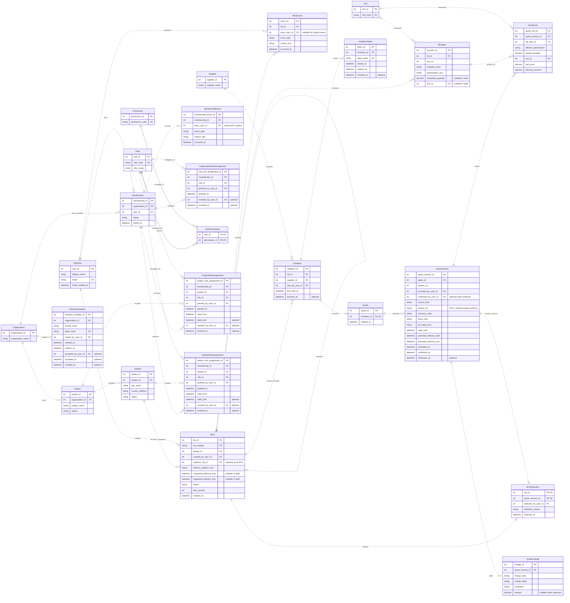

# BuildSupply Hub ER Model

RFQ and Organization settings model from Page-2 of `BuildSupply Hub Sitemap.drawio`.

This view shows the main relationships. Actor foreign keys remain listed even where their connectors are omitted.

