# BuildSupply Hub ER Model

RFQ, Organization settings, and Payments and returns model from Page-2 of `BuildSupply Hub Sitemap.drawio`.

This view shows the main relationships. Actor foreign keys remain listed even where their connectors are omitted.

`PurchaseOrder`, `POLine`, and `GoodsPortion` are reference entities; their detailed upstream models are still pending.

```mermaid
erDiagram
    direction LR
    %% Simplified view: actor FK fields remain; only primary AppUser relationships are drawn.
    Organization ||..o{ Project : owns
    Project ||..o{ Jobsite : contains
    Jobsite ||..o{ RFQ : receives_requests
    AppUser ||..o{ RFQ : creates
    RFQ ||..o{ RFQItem : contains
    Unit o|..o{ RFQItem : measures
    RFQ ||..o{ RFQEvent : records
    AppUser o|..o{ RFQEvent : performs
    RFQ o|..o{ RFQ : replaces
    RFQ ||..o{ Invitation : invites_through
    Supplier ||..o{ Invitation : receives
    Invitation ||..o{ InvitationToken : issues
    Invitation ||..o| Quote : receives
    Quote ||..o{ QuoteVersion : versions
    QuoteVersion ||..o{ QuoteLine : prices
    RFQItem ||..o{ QuoteLine : quoted_for
    Unit ||..o{ QuoteLine : measures
    QuoteVersion ||..o{ QuoteCharge : adds
    RFQ ||..o| RFQSelection : selects
    QuoteVersion ||..o| RFQSelection : chosen_version

    Organization {
        int organization_id PK
        string organization_name
    }
    AppUser {
        int user_id PK
        string display_name
        string email UK
        datetime email_verified_at
    }
    Jobsite {
        int jobsite_id PK
        int project_id FK
        string site_name
        string current_address
        string status
    }
    Unit {
        int unit_id PK
        string unit_code UK
    }
    RFQ {
        int rfq_id PK
        string rfq_number UK
        int jobsite_id FK
        int created_by_user_id FK
        int replaces_rfq_id FK "optional; prior RFQ"
        string delivery_address_text
        datetime requested_delivery_start "nullable in draft"
        datetime requested_delivery_end "nullable in draft"
        string status
        int lock_version
        datetime created_at
    }
    RFQItem {
        int rfq_item_id PK
        int rfq_id FK
        int line_no
        string material_name
        string specification_text
        decimal requested_quantity "nullable in draft"
        int unit_id FK "nullable in draft"
    }
    RFQEvent {
        int event_id PK
        int rfq_id FK
        int actor_user_id FK "nullable for system event"
        string event_type
        string reason_text
        datetime occurred_at
    }
    Supplier {
        int supplier_id PK
        string supplier_name
    }
    Invitation {
        int invitation_id PK
        int rfq_id FK
        int supplier_id FK
        int sent_by_user_id FK
        datetime first_sent_at
        datetime declined_at "optional"
    }
    InvitationToken {
        int token_id PK
        int invitation_id FK
        string token_hash UK
        datetime issued_at
        datetime expires_at
        datetime revoked_at "optional"
    }
    Quote {
        int quote_id PK
        int invitation_id FK, UK
        datetime created_at
    }
    QuoteVersion {
        int quote_version_id PK
        int quote_id FK
        int version_no
        int recorded_by_user_id FK
        int confirmed_by_user_id FK "optional until confirmed"
        string source_kind
        string source_ref "FULL: external quote evidence"
        string currency_code
        string terms_text
        string tax_basis_text
        datetime valid_until
        datetime promised_delivery_start
        datetime promised_delivery_end
        datetime submitted_at
        datetime confirmed_at
        datetime withdrawn_at "optional"
    }
    QuoteLine {
        int quote_line_id PK
        int quote_version_id FK
        int rfq_item_id FK
        string offered_specification
        decimal quoted_quantity
        int unit_id FK
        decimal unit_price
        decimal discount_amount
    }
    QuoteCharge {
        int charge_id PK
        int quote_version_id FK
        string charge_type
        string charge_label
        string treatment
        decimal amount "nullable when unknown"
    }
    RFQSelection {
        int rfq_id PK, FK
        int quote_version_id FK, UK
        int selected_by_user_id FK
        string selection_reason
        datetime selected_at
    }

    %% Organization settings: membership, explicit roles and scoped access.
    Organization ||..o{ Membership : has_members
    AppUser ||..o{ Membership : joins
    Organization ||..o{ MemberInvitation : invites
    Membership ||..o{ MembershipEvent : records
    Membership ||..o{ OrganizationRoleAssignment : receives
    Role ||..o{ OrganizationRoleAssignment : assigned_as
    Role ||--o{ RolePermission : grants
    Permission ||--o{ RolePermission : included_in
    Membership ||..o{ ProjectRoleAssignment : receives
    Project ||..o{ ProjectRoleAssignment : scopes
    Role ||..o{ ProjectRoleAssignment : assigned_as
    Membership ||..o{ JobsiteRoleAssignment : receives
    Jobsite ||..o{ JobsiteRoleAssignment : scopes
    Role ||..o{ JobsiteRoleAssignment : assigned_as

    Membership {
        int membership_id PK
        int organization_id FK
        int user_id FK
        string status
        datetime joined_at
    }
    MemberInvitation {
        int member_invitation_id PK
        int organization_id FK
        string invited_email
        string token_hash UK
        int invited_by_user_id FK
        datetime created_at
        datetime expires_at
        int accepted_by_user_id FK "optional"
        datetime accepted_at "optional"
        datetime revoked_at "optional"
    }
    MembershipEvent {
        int membership_event_id PK
        int membership_id FK
        int actor_user_id FK "optional for system"
        string event_type
        string reason_text
        datetime occurred_at
    }
    Role {
        int role_id PK
        string role_code UK
        string role_scope
    }
    Permission {
        int permission_id PK
        string permission_code UK
    }
    RolePermission {
        int role_id PK, FK
        int permission_id PK, FK
    }
    OrganizationRoleAssignment {
        int org_role_assignment_id PK
        int membership_id FK
        int role_id FK
        int granted_by_user_id FK
        datetime granted_at
        int revoked_by_user_id FK "optional"
        datetime revoked_at "optional"
    }
    Project {
        int project_id PK
        int organization_id FK
        string project_name
        string status
    }
    ProjectRoleAssignment {
        int project_role_assignment_id PK
        int membership_id FK
        int project_id FK
        int role_id FK
        int granted_by_user_id FK
        datetime granted_at
        datetime valid_from
        datetime valid_until "optional"
        int revoked_by_user_id FK "optional"
        datetime revoked_at "optional"
    }
    JobsiteRoleAssignment {
        int jobsite_role_assignment_id PK
        int membership_id FK
        int jobsite_id FK
        int role_id FK
        int granted_by_user_id FK
        datetime granted_at
        datetime valid_from
        datetime valid_until "optional"
        int revoked_by_user_id FK "optional"
        datetime revoked_at "optional"
    }

    %% UNIQUE Membership(organization_id,user_id).
    %% Each scoped assignment must belong to its membership organization.
    %% Organization admin does not automatically authorize purchases or PO approval.
    %% Project grants cover child jobsites; jobsite grants cover only that site.
    %% Evaluate active membership, effective unrevoked grants and permission on every action.
    %% Preserve grant history; prevent overlapping duplicate member/role/scope grants.
    %% Protect the last active organization admin; rejoining does not restore revoked grants.
    %% Prepared Project/Jobsite data support MVP US01; self-service creation remains outside P0.

    %% Payments and returns: proposed full detail for US17-US18, with shared fee support.
    %% Actor FKs are retained as attributes; their extra AppUser lines are intentionally omitted.
    Jobsite ||..o{ PurchaseOrder : scopes
    Supplier ||..o{ PurchaseOrder : supplies
    QuoteVersion ||..o{ PurchaseOrder : quoted_basis
    PurchaseOrder ||..o{ POLine : contains
    POLine ||..o{ GoodsPortion : apportioned_as
    PurchaseOrder ||..o{ ProviderPaymentAttempt : checkout_attempts
    ProviderPaymentAttempt ||..o{ PaymentAttemptAllocation : intends
    GoodsPortion ||..o{ PaymentAttemptAllocation : requested_for
    ProviderPaymentAttempt ||..o{ ProviderTransaction : confirmed_transactions
    ProviderTransaction ||..o{ PaymentAllocation : allocates
    GoodsPortion ||..o{ PaymentAllocation : paid_for
    PurchaseOrder ||..o{ GoodsReturn : returned_under
    GoodsReturn ||..o{ GoodsReturnLine : contains
    PaymentAllocation ||..o{ GoodsReturnLine : returned_from
    ProviderTransaction ||..o{ Refund : refunded_by
    Refund ||..o{ RefundAllocation : allocates
    GoodsReturnLine ||..o{ RefundAllocation : refunded_for
    PaymentProviderAccount ||..o{ ProviderPaymentAttempt : processes
    PaymentProviderAccount ||..o{ ProviderEvent : emits
    ProviderEvent ||..o{ ProviderTransaction : confirms
    ProviderEvent o|..o{ Refund : confirms_when_successful
    PaymentAllocation o|..o| CommissionEntry : charge_entry
    RefundAllocation o|..o| CommissionEntry : reversal_entry

    PurchaseOrder {
        int po_id PK "REFERENCE ONLY"
        int jobsite_id FK
        int supplier_id FK
        int quote_version_id FK
    }
    POLine {
        int po_line_id PK "REFERENCE ONLY"
        int po_id FK
    }
    GoodsPortion {
        int goods_portion_id PK "REFERENCE ONLY"
        int po_line_id FK
    }
    ProviderPaymentAttempt {
        int payment_attempt_id PK
        int po_id FK
        int provider_account_id FK
        int initiated_by_user_id FK
        string request_key UK
        decimal requested_gross_amount
        string currency_code
        string status
        datetime created_at
        datetime last_checked_at "optional"
        string failure_reason "optional"
    }
    PaymentAttemptAllocation {
        int attempt_allocation_id PK
        int payment_attempt_id FK
        int goods_portion_id FK
        decimal quantity
        decimal net_goods_amount
        decimal tax_amount
        decimal freight_amount
        decimal other_charge_amount
    }
    ProviderTransaction {
        int transaction_id PK
        int payment_attempt_id FK
        string provider_transaction_key UK "provider/account scoped"
        decimal gross_amount
        string currency_code
        datetime confirmed_at
        int confirmation_event_id FK
        string reconciliation_status
    }
    PaymentAllocation {
        int payment_allocation_id PK
        int transaction_id FK
        int goods_portion_id FK
        decimal paid_quantity
        decimal net_goods_amount
        decimal tax_amount
        decimal freight_amount
        decimal other_charge_amount
    }
    GoodsReturn {
        int return_id PK
        int po_id FK
        int created_by_user_id FK
        string workflow_status
        datetime created_at
    }
    GoodsReturnLine {
        int return_line_id PK
        int return_id FK
        int payment_allocation_id FK
        decimal quantity
        string reason_text
        string return_status
        datetime returned_at "optional until confirmed"
    }
    Refund {
        int refund_id PK
        int transaction_id FK
        int requested_by_user_id FK
        string request_key UK
        string provider_refund_key UK "optional; provider/account scoped"
        decimal requested_gross_amount
        decimal confirmed_gross_amount "optional until confirmed"
        string status
        datetime requested_at
        datetime confirmed_at "optional until confirmed"
        int confirmation_event_id FK "optional until confirmed"
    }
    RefundAllocation {
        int refund_allocation_id PK
        int refund_id FK
        int return_line_id FK
        decimal quantity
        decimal net_goods_amount
        decimal tax_amount
        decimal freight_amount
        decimal other_charge_amount
    }
    PaymentProviderAccount {
        int provider_account_id PK
        string provider_code
        string account_reference
        string status
    }
    ProviderEvent {
        int event_id PK
        int provider_account_id FK
        string provider_event_key UK "provider/account scoped"
        string event_type
        string provider_object_key
        datetime occurred_at
        datetime received_at
        string verification_status
        datetime processed_at "optional until applied"
        string payload_reference
    }
    CommissionEntry {
        int commission_entry_id PK
        int payment_allocation_id FK, UK "optional; CHARGE only"
        int refund_allocation_id FK, UK "optional; REVERSAL only"
        string entry_type
        decimal rate_used
        decimal posted_amount "signed ledger amount"
        datetime created_at
    }

    %% REFERENCE ONLY: PurchaseOrder/POLine/GoodsPortion are integration contracts, not completed upstream models.
    %% PO revisions, approval, receipt/inspection evidence and accepted portion limits remain to be designed there.
    %% UNIQUE PaymentAttemptAllocation(payment_attempt_id,goods_portion_id).
    %% UNIQUE PaymentAllocation(transaction_id,goods_portion_id).
    %% UNIQUE RefundAllocation(refund_id,return_line_id).
    %% UNIQUE PaymentProviderAccount(provider_code,account_reference).
    %% CommissionEntry: exactly one allocation FK; CHARGE uses payment, REVERSAL uses refund.
    %% ProviderTransaction records only verified successful charges; unmatched charges remain reconciliation exceptions.
    %% All allocations must agree on PO, goods portion, original payment, provider account and currency.
    %% Reserve eligible unpaid portions for live attempts; UNKNOWN/PENDING must be reconciled before retry.
    %% Requested/confirmed returns cannot exceed eligible remaining paid quantity.
    %% Pending and confirmed refunds reserve only the remaining refundable quantity and amount.
    %% Refund success requires verified provider evidence matching the original charge and account.
    %% Enforce aggregate caps with transaction locking, not FK checks alone.
    %% Dedupe both provider event keys and provider transaction/refund keys.
    %% Attempt statuses: CREATED/PENDING/SUCCEEDED/FAILED/UNKNOWN.
    %% Return workflow: DRAFT/SUBMITTED/CANCELLED; return lines: REQUESTED/CONFIRMED/CANCELLED.
    %% Refund statuses: REQUESTED/PENDING/SUCCEEDED/FAILED/CANCELLED.
    %% Only confirmed refunds create fee reversals; original charges and fee entries remain immutable.
    %% Fee base excludes tax, freight and other charges; rate and provider terms remain unset.
    %% Final full refund reverses the remaining original fee including rounding residue.
    %% Store money as exact DECIMAL; no card credentials; actor permissions use existing scoped assignments.
    %% This extension does not complete supplier payout/processing-charge models or full-product coverage.
```

