# BuildSupply Hub: Sitemap Walkthrough

## User journey

The arrows show available links. Each user sees pages allowed by their assigned role.

1. **Discover:** From **Home**, browse **Catalog → Material category → Material specification** or use **Search results**. Select a supplier and sign in to start an RFQ, or go straight to **Sign in**.
2. **Request and quote:** The contractor opens **RFQs → Create RFQ → RFQ detail**. The invited supplier replies through **RFQ invitations → Invited RFQ detail → Quote editor**.
3. **Order:** The contractor compares quotes, prepares a purchase order, gets approval, and issues it. The supplier opens **Purchase order detail** to acknowledge or decline it.
4. **Receive and pay:** Record arrival and inspection through **Deliveries and inspections**. Pay only accepted, retained goods through **Accepted-portion checkout**; link any paid return to its **Payment detail**.
5. **Review and manage:** The supplier checks **Payments and payouts**; the operator checks **Hub fee ledger**. Other menu pages cover supplier history, organization settings, and later expansions.

## Mermaid sitemap

```mermaid
%%{init: {"theme":"base","themeVariables":{"fontFamily":"Arial, sans-serif","fontSize":"15px","lineColor":"#94a3b8","edgeLabelBackground":"#ffffff"},"flowchart":{"htmlLabels":false,"curve":"linear","nodeSpacing":20,"rankSpacing":48}}}%%
flowchart TD
    accTitle: BuildSupply Hub website sitemap
    accDescr: Home opens core public discovery and sign-in. Sign-in provides role-scoped buyer, supplier, and operator menus. Read top to bottom. The upper-right priority key marks blue core functions, white navigation pages, and gray dashed later expansions. Visual priority does not change the agreed P0 release scope.
    HOME["Home<br/>(Yi Jie)"]
    CATALOG["Catalog<br/>(Yi Jie)"]
    RESULTS["Search<br/>results<br/>(Yi Jie)"]
    CATEGORY["Material<br/>category"]
    SPEC["Material<br/>specification"]
    LOGIN["Sign in"]

    HOME --> CATALOG
    HOME -->|Search| RESULTS
    HOME --> LOGIN
    CATALOG --> CATEGORY
    CATEGORY --> SPEC

    %% Search results
    SUPPLIER_PROFILE["Supplier<br/>profile"]
    COMPARE["Product<br/>comparison"]
    QUICK_RFQ["RFQ<br/>action"]

    RESULTS --> SUPPLIER_PROFILE
    RESULTS --> COMPARE
    RESULTS --> QUICK_RFQ

    subgraph OPERATOR["PLATFORM ADMINISTRATION"]
        O_MENU(["Operator menu<br/>(Yi Jie)"])
        O_FEES["Hub fee<br/>ledger"]
        O_FEE["Fee entry<br/>detail"]
        O_ONBOARDING["Supplier<br/>onboarding"]
        O_VERIFICATION["Supplier verification<br/>detail"]

        O_MENU --> O_FEES
        O_MENU --> O_ONBOARDING
        O_FEES --> O_FEE
        O_ONBOARDING --> O_VERIFICATION
    end

    subgraph SUPPLIER["SUPPLIER TEAM"]
        S_MENU(["Supplier menu"])
        S_INVITATIONS["RFQ<br/>invitations"]
        S_RFQ["Invited RFQ<br/>detail"]
        S_QUOTE["Quote editor"]
        S_ORDERS["Purchase<br/>orders"]
        S_ORDER["Purchase order<br/>detail"]
        S_PAYMENTS["Payments and<br/>payouts"]
        S_LISTINGS["Public<br/>listings"]
        S_EDITOR["Listing<br/>editor"]

        S_MENU --> S_INVITATIONS
        S_MENU --> S_ORDERS
        S_MENU --> S_PAYMENTS
        S_MENU --> S_LISTINGS
        S_INVITATIONS --> S_RFQ
        S_RFQ --> S_QUOTE
        S_ORDERS --> S_ORDER
        S_LISTINGS --> S_EDITOR
    end

    subgraph BUYER["CONTRACTOR TEAM"]
        B_MENU(["Contractor menu"])
        B_DASH["Dashboard"]
        B_RFQS["RFQs"]
        B_CREATE["Create RFQ"]
        B_RFQ["RFQ detail"]
        B_ORDERS["Purchase<br/>orders"]
        B_ORDER["Purchase order<br/>detail"]
        B_RECEIVING["Deliveries and<br/>inspections"]
        B_RECEIPT["Receipt detail"]
        B_INSPECTION["Inspection"]
        B_PAYMENTS["Payments and<br/>returns"]
        B_CHECKOUT["Accepted-portion<br/>checkout"]
        B_PAYMENT["Payment detail"]
        B_RETURN["Return and<br/>refund detail"]
        B_HISTORY["Supplier<br/>history"]
        B_OUTCOME["Supplier outcome<br/>detail"]
        B_SETTINGS["Organization<br/>settings"]
        B_JOBSITES["Jobsite<br/>settings"]

        B_MENU --> B_DASH
        B_MENU --> B_RFQS
        B_MENU --> B_ORDERS
        B_MENU --> B_RECEIVING
        B_MENU --> B_PAYMENTS
        B_MENU --> B_HISTORY
        B_MENU -->|Organization admin| B_SETTINGS
        B_RFQS --> B_CREATE
        B_RFQS --> B_RFQ
        B_ORDERS --> B_ORDER
        B_RECEIVING --> B_RECEIPT
        B_RECEIPT --> B_INSPECTION
        B_PAYMENTS --> B_CHECKOUT
        B_PAYMENTS --> B_PAYMENT
        B_PAYMENT --> B_RETURN
        B_HISTORY --> B_OUTCOME
        B_SETTINGS --> B_JOBSITES
    end

    LOGIN --> B_MENU
    LOGIN --> S_MENU
    LOGIN --> O_MENU

    subgraph PRIORITY_NOTE["PRIORITY KEY"]
        direction TB
        KEY_CORE["Blue: core function"]
        KEY_NAV["White: navigation page"]
        KEY_LATER["Gray dashed: later expansion"]
    end
    HOME ~~~ PRIORITY_NOTE

    classDef menu fill:#0f172a,stroke:#0f172a,color:#ffffff;
    classDef core fill:#dbeafe,stroke:#2563eb,color:#0f172a;
    classDef page fill:#ffffff,stroke:#64748b,color:#0f172a;
    classDef expansion fill:#f1f5f9,stroke:#64748b,color:#334155,stroke-dasharray:5 3;
    class B_MENU,S_MENU,O_MENU menu;
    class HOME,CATALOG,RESULTS,CATEGORY,SPEC,B_CREATE,B_RFQ,B_ORDER,B_RECEIPT,B_INSPECTION,B_CHECKOUT,B_PAYMENT,B_RETURN,B_HISTORY,B_OUTCOME,B_SETTINGS,S_RFQ,S_QUOTE,S_ORDER,S_PAYMENTS,O_FEES,O_FEE,SUPPLIER_PROFILE,COMPARE,QUICK_RFQ core;
    class LOGIN,B_DASH,B_RFQS,B_ORDERS,B_RECEIVING,B_PAYMENTS,S_INVITATIONS,S_ORDERS page;
    class B_JOBSITES,S_LISTINGS,S_EDITOR,O_ONBOARDING,O_VERIFICATION expansion;
    class KEY_CORE core;
    class KEY_NAV page;
    class KEY_LATER expansion;
    style BUYER fill:#f8fafc,stroke:#cbd5e1
    style SUPPLIER fill:#f8fafc,stroke:#cbd5e1
    style OPERATOR fill:#f8fafc,stroke:#cbd5e1
```

## Box meanings and colors

| Box | Meaning |
|---|---|
| Blue, solid border | Core function, including public discovery and pages with P0 work. |
| White, solid border | Navigation or list page leading to a task or record. |
| Gray, dashed border | Later expansion with no committed release date. |
| Dark, rounded | Role-specific menu, not a content page. |
| Large pale frame | Contractor, supplier, or platform workspace. |

The upper-right key repeats the three page colors. These are sitemap priorities, not a change to the agreed 15-story P0 release scope. The key boxes are examples, not website pages.
